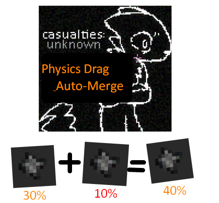

<div align="center">

# 🧲 Physics Drag & Auto-Merge
<div align="center">
  
</div>

**Физическое перетаскивание предметов и авто-слияние для Casualties: Unknown**

[](https://github.com/)
[](https://github.com/BepInEx/BepInEx)
[](https://github.com/)

</div>

---

<details>
<summary><b>🇷🇺 РУССКИЙ (Нажмите, чтобы развернуть)</b></summary>
<br>

  Этот мод добавляет в **Casualties: Unknown** физическое перетаскивание предметов. Теперь, чтобы поднять и переместить вещь, необязательно открывать инвентарь и тянуть её через интерфейс — вы можете таскать предметы прямо в игровом мире!

### ✨ Что добавляет
*   **🖱️ Захват ПКМ:** Зажмите правую кнопку мыши на любом предмете, и он начнет плавно притягиваться к вашему курсору. Отпустите кнопку — и он упадет.
*   **🔄 Автоматическое слияние:** Забудьте про ручное перетаскивание в инвентаре! Теперь достаточно просто бросить один кусок ресурса на другой. Если это одинаковые предметы, они автоматически объединят свой процент (например, 20% + 80% = 100%).

### ⚖️ Баланс и физика
*   **Ощущение веса:** Тяжелые предметы отстают, легкие летят быстро. Встроен лимит скорости, чтобы предметы не пролетали сквозь стены.
*   **📏 Лимит дистанции:** Если предмет отлетит от вас дальше **12** игровых клеток, он автоматически выпадет.
*   **Запрет на самоподъем:** Вы не можете схватить себя за руку или ногу.

### 🛠️ Установка
```text
1. Убедитесь, что у вас установлен **BepInEx 5** и библиотека **ScavLib**.
2. Скачайте файл `Physics Drag & Auto-Merge.dll`.
3. Поместите его в папку: 
   Casualties_Unknown\BepInEx\plugins\
   Запускайте игру!
   ```

</details>
<details> <summary><b>En ENGLISH (Click to expand)</b></summary> <br>
   This mod adds physics-based item dragging to Casualties: Unknown. Now, to pick up and move an item, you don't have to open the inventory and drag it through the interface — you can drag objects directly in the game world!

✨ Features
🖱️ Right-Click Grab: Hold the Right Mouse Button on any item, and it will smoothly pull towards your cursor. Release the button, and it will drop.

🔄 Auto-Merge Resources: Forget manual dragging in the inventory! Now just throw one piece of resource onto another. If they are the same items, they will automatically combine their percentage (e.g., 20% + 80% = 100%).

⚖️ Balance & Physics
Realistic Weight: Heavy items lag behind, light items fly fast. A built-in speed limit prevents items from flying through walls (tunneling).

📏 Distance Limit: If the item flies further than 12 game tiles away from you, it will automatically drop.

No Self-Lifting: You cannot grab yourself by the arm or leg.

🛠️ Installation
```text
Make sure you have BepInEx 5 and the ScavLib library installed.
Download the Physics Drag & Auto-Merge.dll file.
Place it in the folder:
Casualties_Unknown\BepInEx\plugins\
Launch the game!
```
</details>
<div align="center"> <i>Made with ❤️ by Hati</i> </div>
<div align="center">  </div>

